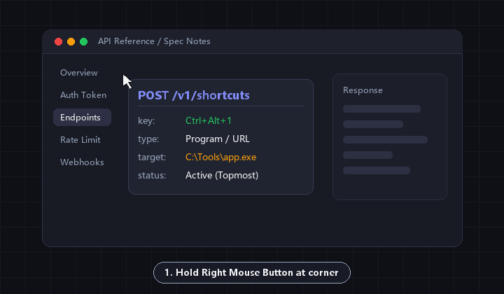

# Vector — 全局快捷键与鼠标手势贴图工具 / Global Hotkey & Gesture Pin Tool (v2.1.0)

[](LICENSE)
[](https://dotnet.microsoft.com/)
[](https://www.microsoft.com/windows)
[](https://github.com/luxp1990/Vector/releases)

> 如果你受够了每次打开常用工具都要在一堆图标和窗口里来回翻找，或者只是想把一段报错、一张参考图临时钉在屏幕最前面却要按好几步截图再贴图，不妨试试 **Vector**。

---

### 💡 为什么要写这个软件？

日常写代码、看文档、做对比的时候，有两个高频小动作一直让人很不爽：

- **频繁切应用太打断思路**：常用的终端、脚本、文件夹、网页工具分散在桌面和浏览器里，每次用都要切窗口、找图标；市面上的启动器要么功能太重、要么热键管理不够直观。
- **临时对照参考太繁琐**：看到一段参数、一张图表或报错信息，想随手把它「钉」在屏幕最前面边看边写，传统工具往往要先按截图快捷键、再框选、再点「贴图」——手已经从鼠标挪到键盘又挪回鼠标了。

于是干脆自己写了 **Vector** —— 一个常驻系统托盘的轻量级 Windows 工具，只保留最直接、最高频的两个能力：

- **一套极简全局快捷键**：把常用程序、文件夹、网页和脚本绑到顺手的组合键上，一键直达，还支持总开关一键暂停/恢复、前置应用智能避让，以及高权限窗口穿透。
- **一笔鼠标手势直接贴图**：**按住鼠标右键逆时针画一个方框**，松开手，框里的内容立刻变成一张置顶贴图留在原地——不用切工具、不用敲键盘，单手一气呵成。

基于 **.NET 8 (WPF) + WinForms NotifyIcon** 原生构建，单进程运行、无外部依赖，支持**简体中文 / English**、**深色 / 浅色主题**以及**响应式窄屏布局**，同时内置 **Model Context Protocol (MCP)** 命名管道服务。

---

### 🎯 核心玩法：鼠标手势贴图

手势贴图是 Vector 最核心、也最顺手的功能——**全程只需要鼠标右键**：

1. **按住鼠标右键**不放；
2. 在屏幕上**逆时针画一个方框**（闭合的近似矩形即可，支持跨多显示器绘制）；
3. **松开鼠标右键**，方框内的屏幕内容就会立刻被截取并原位变成一张**置顶贴图**！



#### 贴图交互与补充方式
- **贴图窗口操作**：**左键拖动**任意移动位置，**鼠标滚轮**调节透明度（25% ~ 100%），**右键 / 双击 / `Esc` / `Delete`** 一键关闭。
- **快捷键框选 & 剪贴板贴图**：除了手势画框，也支持 `Ctrl+Alt+A` 框选贴图与 `Ctrl+Alt+S` 一键贴出剪贴板图片（均可在设置中自定义，并支持开启「截图后自动复制到剪贴板」）。
- **多屏与高分屏像素级对齐**：完整适配多显示器虚拟桌面与 125%~250% DPI 缩放，贴图原位严丝合缝，无 DWM 截屏残影。

---

### 📦 下载与使用

前往本仓库的 [Releases 页面](https://github.com/luxp1990/Vector/releases) 下载单文件绿色版（解压后仅包含单个 `Vector.exe`，双击即可运行；配置与日志位于 `%AppData%\Vector\`）：

| 发布包 | 发布模式 | 运行环境要求 | 特点说明 |
| :--- | :--- | :--- | :--- |
| `Vector-v2.1.0-win-x64.zip` | **默认完整版** (`self-contained`) | 无需预装 .NET | 内置 .NET 8 运行时，开箱即用 |
| `Vector-v2.1.0-win-x64-light.zip` | **轻量版** (`framework-dependent`) | 需预装 **.NET 8 Desktop Runtime (x64)** | 依赖系统运行时，体积显著更小 |

---

### ✨ 核心特性

- **⌨️ 全局快捷键管理**：
  - 支持 `Ctrl / Alt / Shift / Win` 任意组合，录入时实时捕获按键并自动过滤系统保留键（如 `Ctrl+C`、`Alt+F4`、`F5`）。
  - 支持 **程序（`.exe` / 含参数与工作目录）**、**文件夹**、**网页（`http/https`）**、**任意文件/脚本（`.bat/.cmd/.ps1/.vbs`）** 四种目标类型，拖入自动识别并解开 `.lnk` / `.url` 快捷方式。
  - 提供独立**全局开关热键**（如 `Ctrl+Alt+V`）与分功能开关，一键临时暂停/恢复监听；支持单步撤回（`Ctrl+Z`）、类型排序与 JSON 导入导出。
- **🛡️ 智能避让与 UIPI 提权**：
  - 支持全屏态与指定前台进程（如微信、Chrome、Excel、VS Code 等）热键避让，不抢占应用自身快捷键；全局开关热键绝不让渡。
  - 支持「以管理员模式启动」自举 UAC 提权，使热键可穿透作用于高权限窗口。
- **🎨 现代桌面交互**：
  - 托盘常驻 + 实时状态指示（监听中/已暂停），支持**深色 / 浅色**主题与**简体中文 / English** 实时切换，窄窗口下自动切换顶部紧凑栏与收纳设置面板。
- **🔌 原生 MCP 服务**：
  - 内置命名管道服务端（`Vector.Mcp`，仅限当前用户 SID）与 `Vector.exe --mcp-bridge` stdio 桥接，默认全关，写/执行工具需显式开启并校验 `McpToken`。

---

### 🛠️ 构建、测试与架构

#### 目录结构
```text
Vector/
├─ App.xaml(.cs)            应用入口 / DI / 单实例 / 提权 / 异常兜底
├─ MainWindow.xaml(.cs)     主窗口 UI、响应式布局与设置面板
├─ Vector.csproj            项目文件 (net8.0-windows, WPF + WinForms)
├─ Models/                  AppSettings / PinSettings / ShortcutConfig / UndoEntry
├─ Services/                热键 / 手势 / 截图 / 贴图编排 / 设置 / 执行 / 主题 / MCP
├─ Windows/                 贴图设置 / 轨迹层 / 框选层 / 贴图窗口
├─ Resources/               中英文词典、图标与演示动图
├─ Themes/                  Dark.xaml / Light.xaml / Styles.xaml
└─ tests/                   run_all.py 与 Vector.RegressionTests 契约测试工程
```

#### 本地构建与发布
```powershell
# 还原依赖并编译 Release
dotnet build Vector.csproj -c Release

# 运行（首次建议管理员身份以获得完整热键穿透能力）
dotnet run -c Release

# 发布默认完整版单文件 → publish/Vector.exe
dotnet publish Vector.csproj -c Release -r win-x64 --self-contained true -p:PublishSingleFile=true -p:IncludeNativeLibrariesForSelfExtract=true -o publish

# 发布轻量版单文件 → publish-light/Vector.exe
dotnet publish Vector.csproj -c Release -r win-x64 --self-contained false -p:PublishSingleFile=true -p:IncludeNativeLibrariesForSelfExtract=true -o publish-light

# 运行全量回归测试（编译 + GestureOverlayWindow 契约测试 + 真实进程集成验证）
python tests\run_all.py
```

---

### 🤖 MCP 接入配置示例

先启动 Vector 并在设置面板中开启 **MCP 命名管道服务**。当主程序未运行或未开启 MCP 时，`--mcp-bridge` 会输出 JSON-RPC 错误并退出。

```json
{
  "mcpServers": {
    "vector": {
      "type": "stdio",
      "command": "C:\\Path\\To\\Vector.exe",
      "args": ["--mcp-bridge"]
    }
  }
}
```

| 工具名称 | 类别 | 所需开关 | 需传 `token` | 说明 |
| :--- | :--- | :--- | :--- | :--- |
| `list_shortcuts` / `get_status` / `export_config` | 只读 | `McpEnabled` | 否 | 查询快捷键、监听状态与导出配置 |
| `add_shortcut` / `update_shortcut` / `delete_shortcut` / `set_listening` / `import_config` | 写操作 | `McpEnabled` + `McpAllowWrites` | 是 | 增删改快捷键、切换监听与导入配置 |
| `execute_shortcut` | 高危执行 | `McpEnabled` + `McpAllowExecute` | 是 | 按索引或热键直接执行目标 |

---

### 📄 开源协议与版本历史

本项目采用 [MIT License](LICENSE) 开源协议。

- **v2.1.0** (2026-11-27)
  - 新增响应式窄屏布局、独立设置面板（`SettingsOverlay`）、自定义滚动条与输入框占位提示优化。
  - 新增 `ShortcutTargetNameConverter` 列表名称/路径双行展示与中英文多语言资源完善。
  - 集成原生 MCP 命名管道服务与 `--mcp-bridge` stdio 桥接模式。
  - GitHub Releases 新增 `framework-dependent` 轻量版单文件发布包。
- **v2.0.2** (2026-11-05)
  - 多显示器跨屏手势轨迹完整显示、原位精准贴图、高分屏像素级对齐与 DWM 截屏帧同步消残影。
- **v2.0.1** (2026-09-29)
  - 修复手势遮罩窗空闲态未离屏导致系统被误判为 `QUNS_BUSY` 的问题。
